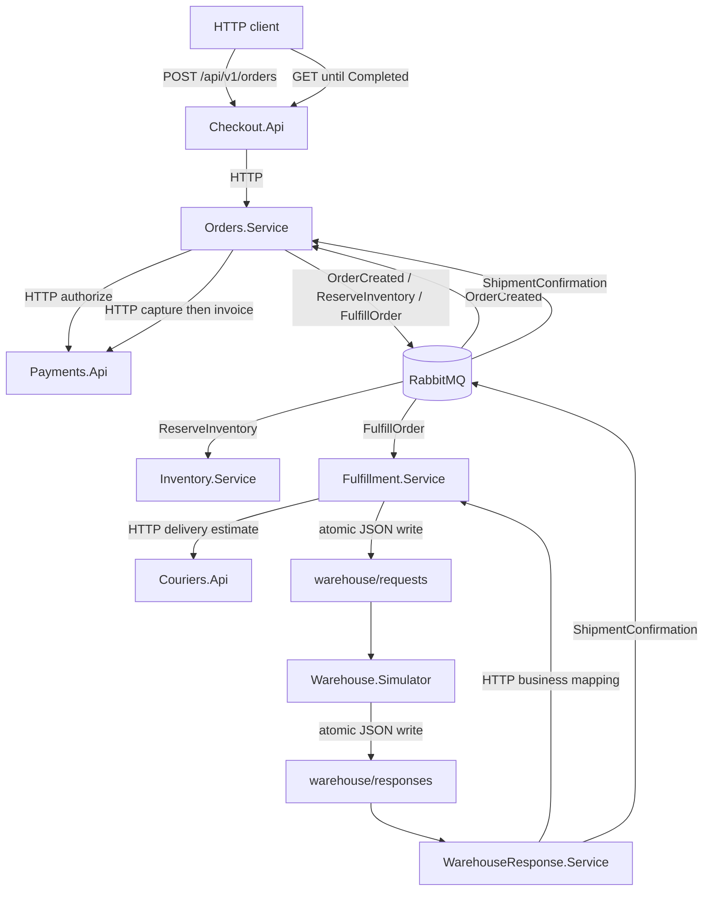

# OpenTelemetryPlayground

**Follow one order across eight .NET services — then instrument the journey yourself.**

A local learning laboratory for developers exploring distributed workflows: HTTP,
RabbitMQ, SQLite and a deliberately file-based warehouse integration. The ecommerce
flow is already implemented, from checkout and payment authorization to shipment,
payment capture and a simulated invoice. Inventory reserves stock independently
while fulfillment proceeds in parallel.

Why the name without OpenTelemetry? This is the starting point for a later hands-on
instrumentation exercise. There are **no application OpenTelemetry SDKs, exporters,
Collector, dashboards, Aspire dependencies, custom spans/metrics or manual trace
context/baggage propagation**. Essential `ILogger<T>`/Serilog console logs and business
IDs let you explore first; runtime/library diagnostics remain untouched.

> macOS execution is implemented, but full macOS runtime acceptance is still open.
> See [verification evidence and platform limits](docs/verification-us13.md).
> Offline checks do not establish that a real order completed on a Mac.

## Contents

- [The journey](#the-journey)
- [Services and ports](#services-and-ports)
- [Platforms and prerequisites](#platforms-and-prerequisites)
- [Quick start](#quick-start)
- [Create an order and verify its invoice](#create-an-order-and-verify-its-invoice)
- [Configuration and simulations](#configuration-and-simulations)
- [Logs, data and warehouse files](#logs-data-and-warehouse-files)
- [Stop, restart and reset](#stop-restart-and-reset)
- [Tests and failure recovery](#tests-and-failure-recovery)
- [Troubleshooting](#troubleshooting)
- [Repository and further reading](#repository-and-further-reading)
- [Learning-project boundaries](#learning-project-boundaries)

## The journey



Each host has its own SQLite database. Outboxes, idempotency and bounded retries
make selected interruptions recoverable. Warehouse JSON carries only the existing
business fields; the return path resolves `WarehouseReference` through Fulfillment.

## Services and ports

All listeners bind to loopback. With `-PortBase 18900`:

| Host | Responsibility | HTTP port / interface |
| --- | --- | --- |
| Checkout.Api | Public order submission and status | 18910: `POST /api/v1/orders`, `GET /api/v1/orders/{orderId}` |
| Orders.Service | Order state, authorization, capture and invoice orchestration | 18911: internal order API |
| Payments.Api | Simulated authorization, capture and invoice | 18912: `GET /api/v1/payments/{orderId}` and internal payment operations |
| Inventory.Service | Independent, idempotent stock reservation | 18913: health only; inspect its database separately |
| Fulfillment.Service | Courier estimate, warehouse request and business mapping | 18914: internal fulfillment/mapping API |
| Couriers.Api | Simulated delivery estimate | 18915: internal courier API |
| WarehouseResponse.Service | Read response files, resolve mapping, publish shipment confirmation | 18916: health only |
| Warehouse.Simulator | Read request files and simulate shipment | 18917: health only |
| RabbitMQ | Business messages and error queues | 18900 AMQP; [18901 management](http://127.0.0.1:18901) |

Every host exposes `/health/ready`. Host offsets are always base+10 through base+17;
broker ports are base and base+1. Default base is **18200**; these examples explicitly
use **18900**. Worktrees still need different port ranges. Consult the
[current flow map](docs/flow-map.md) and [v1 contracts](docs/contracts/README.md)
(both in Italian) for the complete internal routes and message topology.

## Platforms and prerequisites

| Platform | Intended configuration | Verification status |
| --- | --- | --- |
| Linux | .NET + PowerShell; Docker Linux engine | Existing Ubuntu CI runs real broker, all hosts, E2E and recovery tests; current PR status is authoritative |
| Windows | .NET + PowerShell 7; Docker in Linux-container mode | Offline regression CI added; full runtime not executed for US13 |
| macOS Apple Silicon | Native arm64 .NET/PowerShell; Linux arm64 Docker engine | Local host identified as 26.6.2 (25G83), arm64; full runtime blocked by missing prerequisites |
| macOS Intel | Native x64 .NET/PowerShell; Linux amd64 Docker engine | Separate offline CI target; full runtime not verified |

Required on every platform:

- **.NET SDK 10.0.400 exactly**, selected by [`global.json`](global.json) with roll-forward disabled. A runtime alone or SDK 10.0.301 is insufficient.
- **PowerShell 7.2+** (`pwsh`), not Windows PowerShell 5.1.
- **Docker with a running Linux engine and Compose v2 or later**. Start the engine before starting the lab. Installing the CLI alone is insufficient.
- Git, free loopback ports, a writable local checkout, and initial access to NuGet/Docker Hub.

For macOS, follow the official [.NET installation guide](https://learn.microsoft.com/en-us/dotnet/core/install/macos)
and select the pinned SDK's **Arm64** package for Apple Silicon or **x64** for Intel.
Use Microsoft's [PowerShell macOS guide](https://learn.microsoft.com/en-us/powershell/scripting/install/install-powershell-on-macos)
for the matching architecture. Follow [Docker's Mac installation instructions](https://docs.docker.com/desktop/setup/install/mac-install/),
choose the corresponding chip download, and launch Docker Desktop to complete its
setup. These links were checked on 2026-10-25. Installation is a user action;
the laboratory does not install or upgrade system software.

The broker stays pinned to `rabbitmq:4.1.4-management`; no `platform: linux/amd64`
forcing is added. Before claiming native Apple Silicon verification, inspect the
**pinned tag**, not just the current RabbitMQ image family, and check the pulled
image and native SQLite runtime. The [evidence checklist](docs/verification-us13.md)
records what remains unverified.

**Shell: macOS Terminal (zsh). Working directory: repository root after cloning.**

```zsh
sw_vers
uname -m
command -v dotnet pwsh docker
dotnet --version
pwsh -NoProfile -Command '$PSVersionTable'
docker compose version
docker info --format '{{.OSType}}/{{.Architecture}}'
docker buildx imagetools inspect rabbitmq:4.1.4-management
```

Expected: SDK `10.0.400`, PowerShell >=7.2, Compose >=2, and a `linux` engine.
On Apple Silicon prefer native arm64 tools; a successful emulated run is different
evidence and must be labeled as such.

## Quick start

**Shell: zsh (macOS) or PowerShell 7 (Windows/Linux/macOS). Working directory:
start in the parent directory where you want the checkout; `cd` enters its root.**

```text
git clone https://github.com/MarcoMengoli/OpenTelemetryPlayground.git
cd OpenTelemetryPlayground
dotnet restore --locked-mode
dotnet build --no-restore -c Release
dotnet test --no-build -c Release
```

Stop if any command fails. Broker tests skipped here are **not verified**. Packages
are centrally pinned in `Directory.Packages.props` with transitive lock files.

**Shell: zsh. Working directory: repository root. Start Docker Desktop first.**

```zsh
pwsh -NoProfile -File ./scripts/lab.ps1 start -Name explore-manual -PortBase 18900
pwsh -NoProfile -File ./scripts/lab.ps1 ready -Name explore-manual -PortBase 18900
```

**Alternative shell: PowerShell 7. Working directory: repository root.**

```powershell
./scripts/lab.ps1 start -Name explore-manual -PortBase 18900
./scripts/lab.ps1 ready -Name explore-manual -PortBase 18900
```

`start` checks prerequisites and ports, starts a private broker plus all eight hosts,
and waits for readiness. Expect eight `<Service>: ready` lines. Keep the same name
and port base for subsequent commands. Do not run both alternatives to start twice.
Paths with spaces are supported; quote the checkout path when using `cd`.

## Create an order and verify its invoice

Follow the [copyable manual walkthrough](docs/getting-started.md#manual-order-to-invoice).
It selects a fresh environment, submits two BOOK and three PEN items (29.50 EUR),
checks the `202` response and `Location`, polls until `Completed`, verifies Payments
is `Invoiced`, then **waits for Inventory independently**. It also repeats the
identical POST to demonstrate idempotency.

The guide uses its own fresh name on port base 18900: if you already used Quick start,
stop `explore-manual` first using the command below, or change the guide's `$portBase`
to a free range. Run the guide in one PowerShell session so its identifiers persist.
**The manual walkthrough leaves the lab running, even on verification failure.**
Logs and data remain available to investigate; cleanup is a separate explicit step.

A `202 Accepted` means the request was accepted, not that shipping or invoicing
finished. Readiness means infrastructure is available, not that a business workflow
completed. `Completed` has `authorizationId`, `shipmentId`, `captureId`, `invoiceId`
and no `lastError`; Inventory can still be catching up because it runs in parallel.
Do not manually invoke payment capture/invoice to force an order to complete.

## Configuration and simulations

`lab.ps1` derives `Lab__Name`, absolute `Lab__Root`, broker settings and host ports
from `-Name`/`-PortBase`. Per-service HTTP clients default to matching port offsets.
For debugger/manual service launches see [`infra/lab.env.example`](infra/lab.env.example).
`Services__OrdersBaseUrl`, `Services__PaymentsBaseUrl`, `Services__FulfillmentBaseUrl`
and `Services__CouriersUrl` can override those defaults: remove stale overrides in a
fresh exploration session or they may route requests to another lab.

Simulation settings include `Simulation__Profile`, `Simulation__DelayMs`,
`Simulation__FailuresBeforeSuccess`, and optional `Simulation__OrderId` or
`Simulation__WarehouseReference`. Profiles are service-specific: do not apply a
Payments profile to every host. An absent selector differs from an empty string.
Use `-DeclinedOrderId <UUID>` on `start` to scope a declined payment to one order in
Payments only. The [automated E2E](docs/end-to-end.md) covers this path twice.

The [failure/recovery walkthrough](docs/getting-started.md#failure-and-recovery)
reproduces a missing warehouse response and resumes with the same shipment ID.
The [full failure catalog](docs/failure-scenarios.md) (Italian) includes temporary
payment/courier failures, slow responses, duplicate files, quarantine, process
interruptions and broker outages. Retry budgets persist: restarting alone does not
reset an exhausted budget. Recovery preserves business identifiers.

## Logs, data and warehouse files

| Location / resource | What to inspect |
| --- | --- |
| `.local/<Name>/logs/<Service>.log` | Essential Serilog output; follow OrderId, WarehouseReference, ShipmentId, CaptureId, InvoiceId |
| `.local/<Name>/logs/<Service>.err.log` | Host standard error |
| `.local/<Name>/logs/<Service>.runner*.log` | Unix launcher diagnostics, especially failure before the host starts |
| `.local/<Name>/data/<Service>/state.db` | SQLite state, inbox/outbox, retry counters and effects; one DB per service |
| `.local/<Name>/warehouse/requests` | Outbound warehouse request JSON |
| `.local/<Name>/warehouse/responses` | Inbound warehouse response JSON |
| `.local/<Name>/warehouse/processed` | Archived successful files; inspect subdirectories recursively |
| `.local/<Name>/warehouse/errors` | Quarantined invalid/unresolvable files |
| RabbitMQ management on base+1 | Vhost `<Name>`, business exchanges/queues and error queues |

Public **local-only** credentials: `playground` / `local-playground-only`.
Compose project names include the environment and a worktree-path hash; each gets
its own broker volume. Logs append across host restarts. Stop preserves logs,
SQLite files, warehouse files and the broker volume. Reset deletes them.
No service should read another service's database; read-only inspection is a learner/test operation.

## Stop, restart and reset

**Shell: zsh. Working directory: the same repository/worktree root used for start.**

```zsh
pwsh -NoProfile -File ./scripts/lab.ps1 stop -Name explore-manual -PortBase 18900
# Resume the same saved data:
pwsh -NoProfile -File ./scripts/lab.ps1 start -Name explore-manual -PortBase 18900
# Optional destructive cleanup of only this environment, when you are done:
pwsh -NoProfile -File ./scripts/lab.ps1 reset -Name explore-manual -PortBase 18900
```

**Shell: PowerShell 7. Working directory: the same repository root. For the guide's
saved `$name`/`$portBase`, use the corresponding commands in that guide.**

```powershell
./scripts/lab.ps1 stop -Name explore-manual -PortBase 18900
./scripts/lab.ps1 start -Name explore-manual -PortBase 18900
# Optional; deletes this lab's data and broker volume:
./scripts/lab.ps1 reset -Name explore-manual -PortBase 18900
```

Stop checks saved PID, process start identity and executable before requesting a
graceful shutdown. Reset also validates worktree ownership, the original port base
and filesystem links. Never delete the manifest to bypass an identity error, kill
all `dotnet`/`pwsh` processes or run global Docker cleanup. Preserve evidence before reset.

## Tests and failure recovery

**Shell: zsh or PowerShell 7. Working directory: repository root; Release already built.**

```text
pwsh -NoProfile -File ./scripts/test-platform.ps1
dotnet test --no-build -c Release
pwsh -NoProfile -File ./scripts/lab.ps1 verify -Name explore-manual -PortBase 18900
pwsh -NoProfile -File ./scripts/e2e.ps1 -Name explore-auto -PortBase 18500 -NoBuild
```

These are separate checks, with different prerequisites and cleanup:

| Command | Coverage and lifecycle |
| --- | --- |
| `test-platform.ps1` | Offline real process startup across shells, paths with spaces, identity and safety refusals; no Docker/SDK required |
| `dotnet test` | Offline contracts/service/storage tests; broker tests skip unless explicitly enabled |
| `lab.ps1 verify` | Requires that named lab running; enables real broker tests, including US11 private failure labs; leaves the named lab running |
| `e2e.ps1` | Requires Docker; creates fresh `<Name>-1` and `-2`, verifies order/invoice, Inventory, decline and effects twice, then stops/resets only those generated labs |

E2E evidence survives under `.local/e2e-evidence/`. A missing prerequisite, test skip,
timeout or failed cleanup is not success. The [CI workflow](.github/workflows/ci.yml)
keeps full real-Docker verification on Ubuntu and adds offline Windows/macOS checks.
Hosted macOS offline CI does **not** satisfy real Mac Docker acceptance.
See the [guide's single recovery scenario](docs/getting-started.md#failure-and-recovery)
for a narrower real-service test.

## Troubleshooting

| Symptom | Check and recovery |
| --- | --- |
| `pwsh: command not found` | Install PowerShell for the chip architecture using the official guide; open a new terminal and check `command -v pwsh` (zsh, any directory). |
| SDK unavailable | Run `dotnet --version` from the repository root. Install 10.0.400; do not edit `global.json` just to bypass the requirement. |
| Docker unavailable / wrong engine | Start Docker Desktop. From either shell, repository root, run `docker info` and `docker compose version`; engine must be Linux. |
| Native library / architecture error | On macOS run `uname -m` and `dotnet --info` (zsh, repository root). Match Arm64/x64 tools; restore/build again for that architecture. Check pinned image architecture as above. |
| Port occupied | Choose a free name and port range or stop your own environment using its original pair. Do not terminate the owner of an unknown port. |
| Write/permission error | Use a writable checkout and inspect directory permissions. Scripts do not require `sudo` or `chmod 777`; `pwsh -File` does not need an executable bit on `.ps1`. |
| Host never ready | Read `.log`, `.err.log` and Unix `.runner.err.log`; verify broker and DB access. Startup errors preserve evidence under the chosen name. |
| Invalid simulation configuration | Remove unused selectors rather than setting empty strings; start in a fresh dedicated shell and use profiles supported by the intended service. |
| Order pending / HTTP 503 | Inspect `lastError`, logs, outbox/error queues and warehouse folders. A timeout is not a business decline. Apply the owning service's documented recovery after fixing the cause. |
| HTTP 400 / 409 | Use the v1 JSON fields and nonempty UUIDs. Same OrderId with changed content conflicts; do not invent a new key to conceal an uncertain result. |
| Stop/reset refuses | Reuse original worktree/name/base; inspect owner, PID and link warnings. Refusal protects unrelated processes/data. |

## Repository and further reading

| Path | Contents |
| --- | --- |
| `src/` | Eight hosts, shared contracts and laboratory infrastructure |
| `tests/Playground.Tests/` | Contract, offline, broker and failure-recovery tests |
| `tests/Playground.EndToEnd/` | Complete business verifier and read-only Inventory inspection |
| `scripts/`, `infra/` | PowerShell lifecycle/E2E commands and RabbitMQ Compose configuration |
| `docs/`, `.github/` | Guides, evidence, workflow and architectural guard |

Start with the English [getting-started guide](docs/getting-started.md) and
[US13 verification record](docs/verification-us13.md). Detailed guides below are in Italian:

- [Flow map](docs/flow-map.md), [v1 contracts and JSON examples](docs/contracts/README.md)
- [Payments](docs/payments.md), [Checkout/Orders](docs/checkout-orders.md), [completion](docs/order-completion.md), [Inventory](docs/inventory.md)
- [Fulfillment/Couriers](docs/fulfillment.md), [warehouse files](docs/warehouse-files.md), [WarehouseResponse](docs/warehouse-response.md)
- [E2E](docs/end-to-end.md), [failures](docs/failure-scenarios.md), [US12 delivery](docs/delivery.md)

US13 starts from the integrated documentation baseline
[`622aa5f`](https://github.com/MarcoMengoli/OpenTelemetryPlayground/commit/622aa5f),
which includes the application baseline
[`c9f2a06`](https://github.com/MarcoMengoli/OpenTelemetryPlayground/commit/c9f2a065716c657130533225e42ccc0a721454b0)
(US10 + US11). The [initial US02 architecture](docs/architecture/README.md) and
[historical verification](docs/architecture/verification-us02.md) describe the early
foundation; references there to 501 routes or future service work are historical,
not the current implementation.

## Learning-project boundaries

Payments, invoices, couriers and the warehouse are simulated. Stock availability
is guaranteed; reservation does not block fulfillment. There is no UI, one instance
per service, no distributed transaction and no production guarantee. Retries and
operator recovery are deliberately explicit and bounded.

The next exercise is to add instrumentation yourself and observe how the same
business journey crosses HTTP, messaging and files. This baseline leaves that
work to you while preserving the existing warehouse JSON and business-only mapping.
