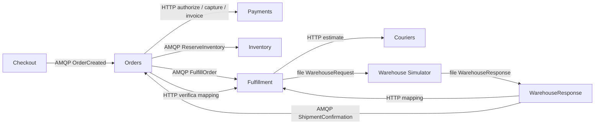

# Seguire un ordine nel codice

Gli otto processi sono ASP.NET Core con readiness uniforme. La porta è
`PortBase + offset`; con base 18900 broker/management sono 18900/18901.

| Host | Offset | Responsabilità attuale | Punto di ingresso |
| --- | ---: | --- | --- |
| Checkout.Api | 10 | POST/GET pubbliche, accettazione e outbox | [CheckoutApplication.cs](../src/Checkout.Api/CheckoutApplication.cs) |
| Orders.Service | 11 | Stato ordine, autorizzazione, comandi, capture e invoice | [OrdersApplication.cs](../src/Orders.Service/OrdersApplication.cs) |
| Payments.Api | 12 | Pagamenti/fatture simulate e idempotenti | [PaymentEndpoints.cs](../src/Payments.Api/PaymentEndpoints.cs), [PaymentStore.cs](../src/Payments.Api/PaymentStore.cs) |
| Inventory.Service | 13 | Prenotazioni e reserved atomici | [InventoryProcessor.cs](../src/Inventory.Service/InventoryProcessor.cs), [InventoryStore.cs](../src/Inventory.Service/InventoryStore.cs) |
| Fulfillment.Service | 14 | Stima, mapping e file-outbox | [FulfillmentProcessor.cs](../src/Fulfillment.Service/FulfillmentProcessor.cs), [FulfillmentStore.cs](../src/Fulfillment.Service/FulfillmentStore.cs) |
| Couriers.Api | 15 | Stima simulata deterministica | [CourierEndpoints.cs](../src/Couriers.Api/CourierEndpoints.cs), [CourierStore.cs](../src/Couriers.Api/CourierStore.cs) |
| WarehouseResponse.Service | 16 | File risposta, lookup e ShipmentConfirmation | [ResponseReader.cs](../src/WarehouseResponse.Service/ResponseReader.cs), [ResponseStore.cs](../src/WarehouseResponse.Service/ResponseStore.cs) |
| Warehouse.Simulator | 17 | Richiesta file e spedizione simulata persistente | [WarehouseProcessor.cs](../src/Warehouse.Simulator/WarehouseProcessor.cs), [SimulatorStore.cs](../src/Warehouse.Simulator/SimulatorStore.cs) |

## Passaggi da individuare

1. Il client sceglie **OrderId** prima della POST. `CheckoutStore.Accept` salva
   richiesta e OrderCreated nella stessa transazione. `OutboxPump.SendNextAsync`
   usa [ConfirmedPublisher.PublishAsync](../src/Playground.Infrastructure/ConfirmedPublisher.cs):
   mandatory e confirm prima di segnare sent. Il MessageId dell'outbox non cambia sui retry.
2. [OrderCreatedConsumer](../src/Orders.Service/OrderCreatedConsumer.cs) valida e
   consuma con ack manuale. [OrderIntake/PaymentAuthorization](../src/Orders.Service/PaymentAuthorization.cs)
   esegue HTTP authorize; [OrdersStore](../src/Orders.Service/OrdersStore.cs) salva
   decisione e comandi ReserveInventory/FulfillOrder. Il rifiuto termina qui senza comandi.
3. [InventoryConsumer](../src/Inventory.Service/InventoryConsumer.cs) e
   [FulfillmentConsumer](../src/Fulfillment.Service/FulfillmentConsumer.cs) procedono
   in parallelo. Inventory committa inbox/prenotazioni/aggregati insieme. Fulfillment
   chiama Couriers, persiste stima, WarehouseReference, mapping e file-outbox prima dell'ack.
4. [WarehouseRequestWriter.WritePending](../src/Fulfillment.Service/WarehouseRequestWriter.cs)
   pubblica il JSON. [WarehouseFiles](../src/Playground.Infrastructure/WarehouseFiles.cs)
   scrive temporaneo, flush e rename nella stessa directory. Il simulatore acquisisce
   e persiste il risultato prima di archiviare la richiesta; pubblica la risposta con
   ShipmentId/ShippedAt originali anche dopo un replay.
5. `ResponseReader.Scan` acquisisce il file; `ResponseLookup.ResumePendingAsync`
   legge il mapping via HTTP Fulfillment. `ResponseStore.Complete` committa associazione
   e outbox ShipmentConfirmation. Il publisher è ancora OutboxPump; file e log contengono
   soltanto i dati business previsti, nessun contesto di tracing.
6. [ShipmentConsumer](../src/Orders.Service/ShipmentConsumer.cs) chiama
   [ShipmentProcessor](../src/Orders.Service/ShipmentProcessor.cs).
   [ShipmentMapping/PaymentCompletion](../src/Orders.Service/CompletionClients.cs)
   verifica il mapping via HTTP, poi capture con AuthorizationId e invoice con CaptureId.
   [ShipmentStore.cs](../src/Orders.Service/ShipmentStore.cs) contiene le transazioni
   Shipped/Captured/Completed. Ack dopo Completed committato; un esito remoto incerto
   si recupera con gli stessi ID. Ogni servizio accede solo al proprio database.

Gli schemi e le query sono accanto alle operazioni nei rispettivi `*Store.cs`.
Le letture incrociate dei database nelle suite sono osservazioni di test; non sono
un protocollo tra servizi. Per cercare i log usare OrderId, poi WarehouseReference
dal mapping e ShipmentId/CaptureId/InvoiceId. Non tutti gli stati rapidi saranno
visibili durante un singolo polling HTTP.

## Code e file

Vhost `<Name>`, exchange direct durevole `<Name>.business.v1`.
[Broker.DeclareAsync](../src/Playground.Infrastructure/Broker.cs) dichiara:

| Body | Routing key | Coda |
| --- | --- | --- |
| OrderCreated | order.created.v1 | `<Name>.orders.order-created.v1` |
| ReserveInventory | inventory.reserve.v1 | `<Name>.inventory.reserve.v1` |
| FulfillOrder | fulfillment.fulfill.v1 | `<Name>.fulfillment.fulfill.v1` |
| ShipmentConfirmation | shipment.confirmed.v1 | `<Name>.orders.shipment-confirmation.v1` |

Error exchange `<Name>.errors.v1`, stessa routing key e coda originale con suffisso
`.errors`. Nessun retry automatico dalla DLQ. JSON/proprietà AMQP e schemi v1 sono
nei [contratti](contracts/README.md). Prefetch 1, manual ack dopo commit, confirm
del publisher e outbox non costituiscono una transazione distribuita.

Sotto `.local/<Name>/warehouse/`: `requests` e `responses` per JSON completati,
`processed/requests` e `processed/responses` per gli archivi, `errors/requests` e
`errors/responses` per quarantena. I nomi derivano da chiavi sanificate; `*.tmp-*`
non viene elaborato. I file portano WarehouseReference; il mapping HTTP restituisce
WarehouseReference/OrderId senza TraceId, SpanId o altri campi diagnostici.

## Stati e recupero

| Stato Orders | Risultato persistito |
| --- | --- |
| Created | Acquisizione dell'ordine |
| PaymentAuthorized | AuthorizationId |
| PaymentDeclined | FailureCode, nessun invio a Inventory/Fulfillment; terminale |
| FulfillmentPending | Entrambi i comandi salvati in outbox |
| Shipped | Mapping validato e ShipmentId |
| Captured | CaptureId |
| Completed | InvoiceId e LastError null; terminale |

Payments segue Authorized → Captured → Invoiced, oppure Declined;
l'annullamento simulato è possibile solo da Authorized. Errori temporanei o retry
esauriti lasciano l'ordine al passo raggiunto, con LastError operativo. Timeout HTTP
5s e budget durevoli limitati: un restart conserva i tentativi e gli effetti remoti.
La disponibilità Inventory è garantita e non esiste una barriera InventoryReserved.

Le procedure di recupero appartengono ai servizi: [Orders](checkout-orders.md),
[completamento](order-completion.md), [Inventory](inventory.md),
[Fulfillment](fulfillment.md), [file](warehouse-files.md),
[WarehouseResponse](warehouse-response.md). Dopo la riparazione della causa,
fermare il servizio interessato prima di intervenire sulla sola chiave verificata.
Non sostituire ID o cancellare DLQ/quarantena per ottenere un falso completamento.
[Catalogo eseguibile dei guasti](failure-scenarios.md).
